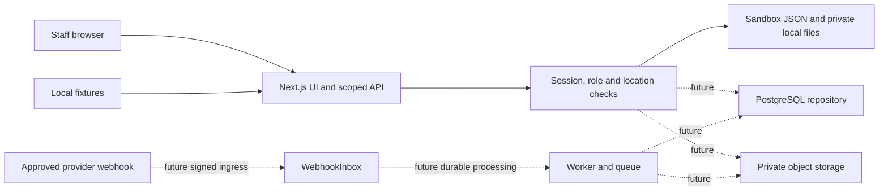

# RTG architecture

## Current implementation and target design

RTG is a Next.js restaurant evidence application. The delivered milestone runs on one developer machine using fictional sandbox orders, a signed sandbox session and private local persistence. It demonstrates order capture, evidence and exports. `RTG_MODE=sandbox` is the only supported runtime mode; production requests must fail closed.

The proposed production design uses PostgreSQL through a pinned Prisma client, private object storage for evidence, and a separate durable worker for webhook processing, synchronization, exports and retention. Those services are not implemented merely by the presence of a schema or worker scaffold. The sandbox repository must be replaced before multi-instance hosting.

## Boundaries and data flows

1. **Order entry:** staff submit a short reference and item list. The API validates input and derives tenant/location from the signed session, persists the order and appends an audit event. A manually entered provider label does not prove that an order came from a provider.
2. **Evidence capture:** `lib/uploads.ts` supports a five-minute signed local upload URL, a one-use authenticated PUT and idempotent completion, alongside direct capture. Signed evidence-read URLs also expire after five minutes and still require the scoped session. These are local API tokens, not object-store presigned URLs. The browser supplies a photo and optional device capture time, seal identifier and handover note. The server checks role/scope, validates size and image contents, stores original bytes outside `public/`, computes SHA-256 and records trusted server receipt time separately. Retention defaults to 30 days and is configurable. Scheduling a retention timestamp is distinct from implementing its deletion worker.
3. **Evidence read/export:** the API resolves the asset through a scoped order and rehashes stored bytes. A mismatch stops the operation. PDF generation includes the order and selected evidence metadata/images, and appends an export audit event. A digest proves consistency with recorded bytes; it does not prove the truth or capture time of the image.
4. **Sandbox ingestion:** an authenticated sandbox route accepts only the known `order.created` fixture shape and records it in `.data/webhook-inbox.json` before normalization. It deduplicates fixture events, records retry/backoff metadata and dead-letters an entry after five failed attempts. Due retries require an explicit admin/manager request; there is no autonomous consumer. An optional local HMAC check exercises fixture signatures. No network request reaches an official provider. Live webhook routes always return 503; cancellations and out-of-order reconciliation are not implemented.
5. **Future provider ingress:** validate the provider's signature over raw bytes and replay window, durably insert a scoped `WebhookInbox` record, then normalize in a worker transaction. Map provider stores to local locations explicitly. Provider event time and server receipt time are both retained. Queue retries must never duplicate an order or acceptance action.
6. **Future retention:** compute each asset/export expiry from the active policy at creation; an authorized worker deletes expired private bytes and appends a lifecycle audit event. Test policy changes, disputes/legal holds where required, backups and failed deletion retries before enabling it.

## Architecture decisions

| ADR | Decision | Reason and consequence |
| --- | --- | --- |
| 001 | Next.js UI and route handlers share validated domain types. | Keeps the first milestone reviewable; server-only authorization remains mandatory. |
| 002 | Local JSON/files are an explicit sandbox adapter. | Provides a working local demo without services. It is single-process state with no production durability or cross-instance locking. |
| 003 | PostgreSQL/Prisma is the production data design. | Composite tenant keys and transactions support isolated memberships, evidence and event processing. A reviewed migration and repository implementation are still required. |
| 004 | Original photos are private; asset IDs are random and bytes are hashed. | No photo is a public static asset. Production requires a private object store and protected audit writes. |
| 005 | Production webhooks and long work will use a separate durable worker. | Fast ingress and retry-safe processing need a persisted inbox/outbox and queue. The persisted local fixture inbox is not a public provider webhook or a Redis queue. |
| 006 | Providers remain disabled until approval and verified integration. | RTG is evidence support. Partner rules determine whether secondary/read-only use is possible and whether order-acceptance control is mandatory. |
| 007 | Production deploys and paid resources need explicit approval. | Preparation and local verification can proceed; a deployment flag cannot grant external authorization. |

## Isolation and permissions

The production hierarchy is Organisation → Location → Order → Evidence. Global identity is connected to an organisation by a membership and role; location grants restrict staff access. Each organisation-owned row has `organisationId`; composite foreign keys prevent cross-organisation references. See [DATA_MODEL.md](DATA_MODEL.md).

The sandbox uses `tenantId` on domain records and a fixed fictional tenant. Its `ADMIN`, `MANAGER`, `STAFF` and `VIEWER` roles demonstrate scope and write rejection. The production schema also designs `OWNER` and a `Role` entity. Sandbox sessions are openly obtainable for fictional data and are not production sign-in. See [SECURITY.md](SECURITY.md).

## Integrations and deployment

Provider capabilities and approval questions are in [API_INTEGRATIONS.md](API_INTEGRATIONS.md). Local setup and the prepared GitHub/Vercel release path are in [docs/DEPLOYMENT.md](docs/DEPLOYMENT.md). PostgreSQL migrations, production identity, S3-compatible storage, a durable queue, billing and consent workflows remain separate implementation milestones. No production service or live provider connection should be described as complete until its path is exercised against an authorized environment.

The Redis/BullMQ service remains a design in [workers/README.md](workers/README.md). A persistent consumer must run outside Vercel request handlers. Pending upload cleanup and evidence retention execution remain unimplemented. GitHub Actions CI is scaffolded in `.github/workflows/ci.yml`, with validation/browser checks and no deployment step.
